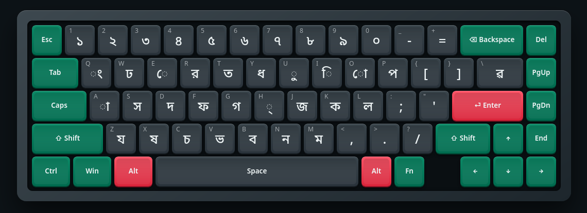
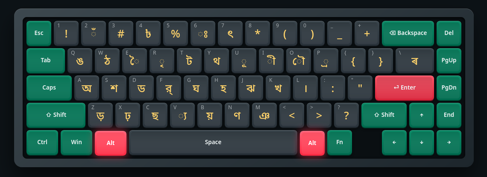

# ibus-bornona

**ibus-bornona** is a native, lightweight Bengali input method engine for IBus implementing the **Bornona (বর্ণনা)** fixed layout in pure Rust.

Designed for Linux desktop environments (GNOME, COSMIC, KDE, XFCE), it provides instant layout switching with <kbd>Alt</kbd>+<kbd>Space</kbd>, built-in typing automation rules, and zero runtime dependencies beyond standard `libibus-1.0` and `gtk+-3.0` / `webkit2gtk-4.1`.

---

## Keyboard Layout Reference

You can display the native graphical layout viewer at any time by running:

```bash
ibus-bornona layout
```

### Primary Layout (Normal Keys)

The standard typing layer for consonants, Bengali digits, and primary vowel signs (Kars).



### Secondary Layout (Shift / Alt Keys)

The shifted layer accessed with <kbd>Shift</kbd> or <kbd>Alt</kbd>, providing independent vowels, conjuncts, special characters, Assamese letters, currency symbols, and signs.



---

## Quick Install

Install with a single command (no root privileges required):

```bash
curl -LsSf https://raw.githubusercontent.com/rmahbub01/ibus-bornona/master/install.sh | sh
```

### Uninstallation

To remove `ibus-bornona`:

```bash
curl -LsSf https://raw.githubusercontent.com/rmahbub01/ibus-bornona/master/install.sh | sh -s -- --uninstall
```

---

## Manual Build & Installation

### Prerequisites

Ensure you have Rust (`cargo`), `make`, `pkg-config`, `ibus`, `gtk3`, and `webkit2gtk` development libraries installed:

- **Fedora / RHEL**:
  ```bash
  sudo dnf install cargo rust make pkgconfig ibus-devel glib2-devel gtk3-devel webkit2gtk4.1-devel
  ```
- **Ubuntu / Debian**:
  ```bash
  sudo apt install cargo rustc make pkg-config libibus-1.0-dev libglib2.0-dev libgtk-3-dev libwebkit2gtk-4.1-dev
  ```
- **Arch Linux**:
  ```bash
  sudo pacman -S rust make pkgconf ibus glib2 gtk3 webkit2gtk-4.1
  ```

### Build & Install

```bash
git clone https://github.com/rmahbub01/ibus-bornona.git
cd ibus-bornona
./install.sh
```

Or using `make`:

```bash
make install-user   # Installs to ~/.local
ibus-bornona setup  # Registers input source & shortcut
```

For a user-local installation on GNOME, `setup` configures the IBus user
service to discover components in `~/.local` and refresh its component list
when it starts. If Bornona is missing from **Settings > Keyboard > Input
Sources**, run `ibus-bornona setup` and then check `ibus-bornona doctor`.

For system-wide installation across all user accounts:

```bash
sudo ./install.sh
```

### Uninstalling a Makefile installation

From the repository directory, use the target matching the installation:

```bash
make uninstall-user                 # Remove an install made with make install-user
sudo make uninstall                 # Remove the default /usr/local installation
sudo make PREFIX=/usr uninstall     # Remove an installation made with PREFIX=/usr
```

Plain `make uninstall` also detects and removes `~/.local` when there is no
`/usr/local` installation. For a custom prefix, pass the same `PREFIX` value
used during installation, for example `sudo make PREFIX=/opt uninstall`.

---

## CLI Usage

The `ibus-bornona` binary provides built-in utilities for layout viewing, setup, diagnostics, and testing:

```text
ibus-bornona: Bornona Bengali Fixed Layout Input Method for IBus
USAGE:
    ibus-bornona <command>

COMMANDS:
    setup            Add Bornona to your DE input sources (Alt+Space to switch)
    doctor           Check that everything is installed and running
    layout           Show native graphical layout popup
    compose <keys>   Show what a key sequence types, e.g. `ibus-bornona compose bFNna`
    version          Print the version
```

### Visual Layout Popup (`layout`)

Open a native, rendered HTML keyboard layout reference window:

```bash
ibus-bornona layout
```

### System Health Check (`doctor`)

Verify your installation and desktop integration:

```bash
ibus-bornona doctor
```

Output:
```text
[ ok ] IBus component file installed
[ ok ] ibus-daemon is running
[ ok ] ibus lists the bornona engine
[ ok ] Bornona is in GNOME input sources
[ ok ] Alt+Space switches input sources
[ ok ] IBus Alt+Space trigger is configured
```

### Key Sequence Preview (`compose`)

Inspect what a keystroke sequence produces without opening a GUI editor:

```bash
ibus-bornona compose bFNna
# বর্ণনা

ibus-bornona compose "ami baqlaB gan gai"
# আমি বাংলায় গান গাই
```

---

## Smart Typing Features

- **Preedit Composition**: Typed keys compose in IBus's underlined preedit buffer and are committed on Space, Enter, focus change, or an unhandled key.
- **Composition-Aware Backspace**: <kbd>Backspace</kbd> restores the preedit state before the previous physical key, including automatic vowel ordering and conjunct transformations.
- **Automatic Vowel Forming**: Initial vowel keys automatically form independent vowels (`a` -> `আ`, `i` -> `ই`, `u` -> `উ`, `o` -> `ও`, `A` -> `অ`).
- **Direct Hasanta and Kar Input**: A single `h` immediately inserts Hasanta (`্`). A following vowel key inserts its Kar, so `ha`, `hi`, and `hI` produce `্া`, `্ি`, and `্ী`; after a consonant, `kha` produces `ক্া`.
- **Zero-Width Non-Joiner**: Type the dedicated backtick key (`\u{0060}`) to insert a Zero-Width Non-Joiner (`\u{200C}`).
- **Fixed-Layout Automation**: Supports left-standing vowel ordering (`ik` -> `কি`), chandrabindu placement (`k@a` -> `কাঁ`), old-style reph movement (`bNFna` -> `বর্ণনা`), phalas (`pPaNe` -> `প্রাণে`), and zo-fola with ZWJ after Ra (`rV` -> `র‍্য`).
- **Numpad Mapping**: Numeric keypad digits directly type Bengali numbers `০`–`৯`.

---

## License

GNU General Public License v3.0 or later ([GPL-3.0-or-later](LICENSE)).
